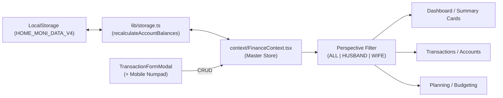
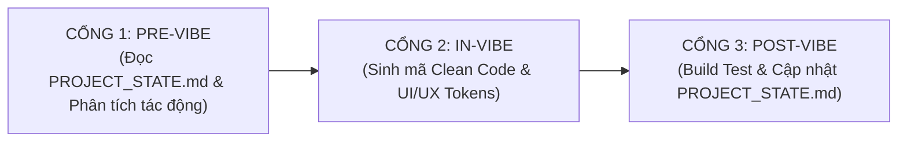

# 🏛️ HOME MONI - TÀI LIỆU KIẾN TRÚC HỆ THỐNG & ĐẶC TẢ NGHIỆP VỤ
> **Dự án:** HOME MONI (Nền tảng Quản lý Tài chính Gia đình & Tổ ấm Song Hành)  
> **Phiên bản:** v3.3 (Streamlined Sidebar UX Edition)  
> **Thời gian đóng gói:** 2026-10-25T06:23:36.838Z  
> **Storage Key hoạt động:** `HOME_MONI_DATA_V4`  
> **Kiến trúc cốt lõi:** Local-First (LocalStorage trình duyệt, Không backend server, Chuẩn PWA di động)

---

## 👨‍👩‍👧 1. TỔ TỔNG QUAN VÀ ĐỊNH VỊ CHỦ THỂ GIA ĐÌNH

### 1.1. Tôn chỉ & Tên thương hiệu
- **Tên ứng dụng:** **HOME MONI** (Home Moni).
- **Khẩu hiệu:** *"Tổ ấm hạnh phúc - Tài chính minh bạch - Vun vén tương lai"*.
- **Ý nghĩa biểu tượng:** Ngôi nhà đan xen trái tim và đồng xu tượng trưng cho sự gắn kết vợ chồng cùng vun đắp tổ ấm.

### 1.2. Ba góc nhìn tài chính cốt lõi (Perspective Switcher)
Hệ thống cung cấp thanh lọc góc nhìn trên đầu trang (TopBar Header) để chuyển đổi nhanh:
1. **🏡 My Home (Tổ ấm / Quỹ chung):** Tổng hợp bức tranh tài sản ròng, tổng thu nhập, tổng chi tiêu và ngân sách của toàn bộ gia đình.
2. **👨 Anh Chuột (Chồng):** Tập trung xem các tài khoản lương Vietinbank, tài khoản chi tiêu BIDV, thẻ tín dụng BIDV 50M và các giao dịch do Anh Chuột phụ trách.
3. **👩 Bé Mèo (Vợ):** Tập trung xem tài khoản lương Vietcombank, tài khoản chi tiêu ACB, thẻ tín dụng BIDV 20M và các giao dịch do Bé Mèo phụ trách.

---

## 💳 2. HỆ THỐNG TÀI KHOẢN THỰC TẾ & HẠN MỨC THẺ TÍN DỤNG

Bảng cấu trúc 6 tài khoản ngân hàng + 1 quỹ tiền mặt cố định:

| Chủ Sở Hữu | Tên Tài Khoản | Loại | Vai Trò Nghiệp Vụ | Hạn Mức / Chu Kỳ Sao Kê | Mã Màu Nhận Diện |
| :--- | :--- | :--- | :--- | :--- | :--- |
| **👨 Anh Chuột** | `acc_husband_vietinbank` | BANK | Chính - Nhận lương Anh Chuột | Tài khoản thanh toán | `#005CA9` (Vietinbank) |
| **👨 Anh Chuột** | `acc_husband_bidv` | BANK | Phụ - Chi tiêu sinh hoạt hằng ngày | Tài khoản thanh toán | `#0A6E3F` (BIDV) |
| **👨 Anh Chuột** | `acc_husband_bidv_credit` | CREDIT_CARD | Thẻ tín dụng mua sắm trả sau | **Hạn mức: 50.000.000 ₫**<br>Sao kê ngày 20, Trả ngày 25 | `#1E3A8A` (Navy BIDV) |
| **👩 Bé Mèo** | `acc_wife_vcb` | BANK | Chính - Nhận lương Bé Mèo | Tài khoản thanh toán | `#008542` (Vietcombank) |
| **👩 Bé Mèo** | `acc_wife_acb` | BANK | Phụ - Chi tiêu cá nhân, đi chợ | Tài khoản thanh toán | `#0060AF` (ACB) |
| **👩 Bé Mèo** | `acc_wife_bidv_credit` | CREDIT_CARD | Thẻ tín dụng mua sắm trả sau | **Hạn mức: 20.000.000 ₫**<br>Sao kê ngày 22, Trả ngày 28 | `#D97706` (Amber BIDV) |
| **🏡 My Home** | `acc_family_cash` | CASH | Quỹ tiền mặt chi tiêu lặt vặt | Quỹ chung trong nhà | `#10B981` (Emerald) |

### ⚠️ QUY TẮC BẤT BIẾN: CƠ CHẾ HẠCH TOÁN THẺ TÍN DỤNG
- Trường `currentBalance` của thẻ tín dụng thể hiện **DƯ NỢ ĐANG DÙNG** (số tiền đang nợ ngân hàng).
- **Chi tiêu bằng thẻ tín dụng (EXPENSE):** Làm **TĂNG** `currentBalance` (tăng dư nợ).
- **Thanh toán nợ thẻ (TRANSFER):** Chuyển tiền từ tài khoản thanh toán sang thẻ tín dụng làm **GIẢM** `currentBalance` (giảm dư nợ).
- **Công thức tính Tài sản ròng (Net Worth):**
  ```
  Net Worth = (Tổng số dư tài khoản BANK + CASH + E_WALLET) 
            + (Tổng giá trị ĐẦU TƯ: Vàng, Sổ tiết kiệm) 
            - (Tổng NỢ VAY ngoài) 
            - (Tổng DƯ NỢ ĐANG DÙNG của 2 thẻ tín dụng BIDV Credit)
  ```

---

## 🎨 3. QUY CHUẨN THIẾT KẾ & FINTECH DESIGN TOKENS

Trích xuất từ `.agents/skills/lovely-money-uiux/SKILL.md`:
- **Primary Navy:** `#1E3A8A` (Thanh điều hướng Sidebar, thương hiệu chính)
- **Active Blue:** `#2563EB` (Nút bấm thao tác chính, số dư, liên kết kích hoạt)
- **Income Emerald:** `#10B981` / `#059669` (Khoản thu nhập, tỷ lệ tiết kiệm)
- **Expense Rose:** `#F43F5E` / `#E11D48` (Khoản chi tiêu, dư nợ thẻ)
- **Warning Amber:** `#F59E0B` / `#D97706` (Cảnh báo hạn mức thẻ > 70%, nợ đến hạn)
- **Hình khối (Border Radius):**
  - Cards, Modals, Widgets: `rounded-3xl` (24px)
  - Buttons, Inputs: `rounded-xl` (12px) hoặc `rounded-2xl` (16px)
  - Mobile Floating Action Button: `rounded-full` (`w-14 h-14` bóng mờ lớn)
- **Recharts Invariant:** Luôn sử dụng cờ `isMounted` trước khi render biểu đồ để tránh lỗi sai khác DOM giữa Server và Client (Next.js Hydration Mismatch).

---

## 📋 4. SỔ TỔNG TRẠNG THÁI HIỆN TẠI (LIVING LEDGER)

```markdown
# 🏛️ HOME MONI - LIVING PROJECT STATE LEDGER
> **Last Synchronized:** 2026-10-24T15:20:00+07:00  
> **App Version:** v3.3 (Streamlined Sidebar UX Edition)  
> **Active Storage Key:** `HOME_MONI_DATA_V4`  
> **Build Status:** 🟢 PASSING (`npm run build` verified: 0 errors, 4/4 static pages)  
> **Runtime Environment:** Next.js 14.2.35 (App Router) · React 18 · TypeScript 5 · Tailwind CSS · Recharts

---

## 📌 QUY TẮC BẤT BIẾN CHO MỌI LẦN VIBE CODE (CRITICAL CONSTRAINTS)
> [!IMPORTANT]
> **AI Agent BẮT BUỘC đọc và tuân thủ các điều khoản sau trước khi viết bất kỳ dòng mã nào:**
> 1. **Kiến trúc Local-First:** Toàn bộ dữ liệu nằm trong `localStorage` trên trình duyệt người dùng. Tuyệt đối KHÔNG cài đặt backend database server (Prisma, PostgreSQL, MongoDB, v.v.).
> 2. **Chủ thể Gia đình:** Chính xác 2 thành viên: **👨 Anh Chuột** (Chồng) & **👩 Bé Mèo** (Vợ). Tổ ấm chung: **🏡 My Home**.
> 3. **Cơ chế Thẻ tín dụng (BIDV Credit):** `currentBalance` đại diện cho **DƯ NỢ ĐANG DÙNG** (chi tiêu thẻ làm TĂNG dư nợ, chuyển tiền thanh toán thẻ làm GIẢM dư nợ). Tài sản ròng = Tổng ví khả dụng + Đầu tư - Nợ vay - Dư nợ thẻ.
> 4. **Ngôn ngữ & Thẩm mỹ:** Giao diện 100% Tiếng Việt chuẩn Fintech. Bo góc `rounded-3xl` cho thẻ/modal, `rounded-xl` cho controls. Font Inter. Responsive hoàn hảo Desktop & Mobile (PWA Ready).

---

## 1. Bản Đồ Cấu Trúc Toàn Hệ Thống (Codebase Topology)

```
fi.tracking-moni/
├── AGENTS.md                          # Master Rule: Quy trình 3 bước bắt buộc cho AI Agent
├── PROJECT_STATE.md                   # File này: Single Source of Truth cho toàn dự án
├── .agents/
│   ├── rules/
│   │   ├── 01_pre_vibe.md             # Cổng 1: Chuẩn bị, đọc context, phân tích tác động
│   │   ├── 02_in_vibe.md              # Cổng 2: Chuẩn sinh mã Clean Code & UI/UX Tokens
│   │   └── 03_post_vibe.md            # Cổng 3: Build verification & cập nhật State Ledger
│   └── skills/
│       └── lovely-money-uiux/         # Skill UI/UX: Design Tokens, Recharts specs, Mobile guidelines
├── app/
│   ├── globals.css                    # Tailwind directives & theme styles
│   ├── layout.tsx                     # Root layout, PWA metadata, Inter font
│   └── page.tsx                       # Main orchestrator: Sidebar sticky + TopBar + Views
├── components/
│   ├── common/
│   │   ├── Sidebar.tsx                # Sticky h-screen, Floating Edge Toggle, Mini Profile, Grouped IA
│   │   ├── TopBar.tsx                 # Header, Perspective Switcher (My Home/Chuột/Mèo), Month selector
│   │   ├── MobileDrawer.tsx           # Mobile navigation drawer with perspective switcher
│   │   ├── CategoryIcon.tsx           # Dynamic Lucide icon renderer
│   │   ├── ConfirmDialog.tsx          # Safety confirmation modal
│   │   └── ExportImportModal.tsx      # 1-Click Backup / Restore JSON (Zod verified)
│   ├── dashboard/
│   │   ├── SummaryCards.tsx           # 4 Metric Cards (Net Worth, Income, Expense, Savings)
│   │   ├── DualCreditCardsWidget.tsx  # Quản lý 2 thẻ BIDV Credit (50M & 20M)
│   │   ├── FamilyCashflowWidget.tsx   # Tỷ trọng lương Anh Chuột vs Bé Mèo & Calendar Heatmap 31 ngày
│   │   ├── TrendLineChart.tsx         # Cumulative spending vs budget & balance line chart
│   │   ├── StructureWidgets.tsx       # Mini-widgets: Asset structure, Investments, Debt progress
│   │   └── RecentTransactionsWidget.tsx# 8 recent transactions & monthly budget progress bars
│   ├── transactions/
│   │   └── TransactionFormModal.tsx   # Add/Edit form + Mobile Numpad (+000, 50k, 100k, 200k, 500k)
│   └── views/
│       ├── OverviewView.tsx           # Tổng quan tổ ấm (Charts & Widgets)
│       ├── TransactionsView.tsx       # Sổ giao dịch đa chiều, bộ lọc, tóm tắt chỉ số
│       ├── AccountsView.tsx           # Sổ chi tiết từng ví/thẻ, phân nhóm Anh Chuột, Bé Mèo, My Home
│       ├── PlanningView.tsx           # Ngân sách tháng & Mục tiêu tiết kiệm (Daily Allowance)
│       ├── DebtsInvestView.tsx        # Quản lý khoản vay & danh mục đầu tư (Vàng, Tiết kiệm)
│       ├── GuideView.tsx              # Cẩm nang sử dụng cho 2 vợ chồng
│       └── SettingsView.tsx           # Đổi màu chủ đề (5 colors), sao lưu, nạp demo
├── constants/
│   ├── defaultCategories.ts           # 16 danh mục Thu & Chi mặc định
│   └── mockData.ts                    # 6 tài khoản ngân hàng + thẻ tín dụng, giao dịch T10/2026
├── context/
│   └── FinanceContext.tsx             # Master React Context: State, Selectors, CRUD operations
├── lib/
│   ├── formatters.ts                  # formatVND, formatDateVN, getMonthDisplayLabel
│   ├── storage.ts                     # Engine lưu trữ LocalStorage, recalculate balances
│   └── validations.ts                 # Zod Schemas kiểm thực dữ liệu backup & models
├── public/
│   └── manifest.json                  # Cấu hình PWA (Add to Home Screen)
└── types/
    └── finance.ts                     # TypeScript definitions (FamilyMember, ExpenseScope, Account...)
```

---

## 2. Hệ Thống Tài Khoản & Hạn Mức Thực Tế (Financial Entities)

| Chủ Sở Hữu | Tên Tài Khoản | Loại | Hạn Mức / Vai Trò | Mã Nhận Diện |
| :--- | :--- | :--- | :--- | :--- |
| **👨 Anh Chuột** | `acc_husband_vietinbank` | Bank | Chính - Nhận lương Anh Chuột | `#005CA9` |
| **👨 Anh Chuột** | `acc_husband_bidv` | Bank | Phụ - Chi tiêu sinh hoạt hằng ngày | `#0A6E3F` |
| **👨 Anh Chuột** | `acc_husband_bidv_credit` | Credit Card | **Hạn mức 50.000.000 ₫** (Sao kê 20, Trả 25) | `#1E3A8A` |
| **👩 Bé Mèo** | `acc_wife_vcb` | Bank | Chính - Nhận lương Bé Mèo | `#008542` |
| **👩 Bé Mèo** | `acc_wife_acb` | Bank | Phụ - Chi tiêu cá nhân, đi chợ | `#0060AF` |
| **👩 Bé Mèo** | `acc_wife_bidv_credit` | Credit Card | **Hạn mức 20.000.000 ₫** (Sao kê 22, Trả 28) | `#D97706` |
| **🏡 My Home** | `acc_family_cash` | Cash | Quỹ tiền mặt chi tiêu lặt vặt trong nhà | `#10B981` |

---

## 3. Bản Đồ Dòng Dữ Liệu & Hợp Đồng Giao Tiếp (State & Flow Contracts)



- **Perspective Filtering:**
  - `ALL` (🏡 My Home): Tổng hợp toàn bộ tài sản, giao dịch và nợ của 2 người.
  - `HUSBAND` (👨 Anh Chuột): Lọc tài khoản Vietinbank, BIDV, thẻ BIDV Credit 50M và các giao dịch do Anh Chuột chi.
  - `WIFE` (👩 Bé Mèo): Lọc tài khoản Vietcombank, ACB, thẻ BIDV Credit 20M và các giao dịch do Bé Mèo chi.

---

## 4. Nhật Ký Biến Thiên Vibe Coding (Vibe Session Changelog)

| Phiên (Vibe ID) | Ngày Giờ | Mục Tiêu & Thay Đổi Cốt Lõi | Files Tác Động | Trạng Thái |
| :--- | :--- | :--- | :--- | :--- |
| **VIBE-05** | 2026-10-24 | Tinh gọn UI/UX Sidebar: Xóa bỏ hoàn toàn khối nút lọc góc nhìn dư thừa trên Sidebar & MobileDrawer (dùng thống nhất trên TopBar Header), tối ưu breathing room, hover micro-interactions (`hover:translate-x-1`). | `Sidebar.tsx`, `MobileDrawer.tsx` | 🟢 Verified |
| **VIBE-04** | 2026-10-24 | Thiết lập Hệ thống Quản trị Vibe Coding 3 Tầng & Living State Ledger (`PROJECT_STATE.md`, `AGENTS.md`, `.agents/rules/`). | `PROJECT_STATE.md`, `AGENTS.md`, `.agents/rules/*` | 🟢 Verified |
| **VIBE-03** | 2026-10-24 | Nâng cấp toàn diện UI/UX Sidebar: Sticky `h-screen`, Floating Toggle, Family Mini-Profile, Grouped IA, Badges, Tooltips; đổi danh xưng sang Anh Chuột & Bé Mèo. | `Sidebar.tsx`, `TopBar.tsx`, `MobileDrawer.tsx`, `mockData.ts`, `storage.ts` | 🟢 Verified |
| **VIBE-02** | 2026-10-24 | Chuyển đổi sang WebApp Quản lý Tài chính Gia đình **HOME MONI**, tích hợp 2 thẻ BIDV Credit (50M & 20M), 6 tài khoản, Perspective switcher, Calendar Heatmap, PWA manifest. | `types/finance.ts`, `mockData.ts`, `FinanceContext.tsx`, `DualCreditCardsWidget.tsx`, etc. | 🟢 Verified |
| **VIBE-01** | 2026-10-24 | Khởi tạo nền tảng Full-Stack Next.js 14 App Router, LocalStorage Engine, Reverse-engineer UI/UX chuẩn Fintech từ bộ ảnh tham khảo. | `app/*`, `components/*`, `lib/*`, `constants/*` | 🟢 Verified |

---

## 5. Danh Sách Tính Năng Tiềm Năng (Backlog Roadmap)
- [ ] Bổ sung tính năng lọc giao dịch theo khoảng ngày tùy chọn (Date range picker).
- [ ] Thêm tùy chọn xuất báo cáo PDF / Excel tóm tắt thu chi tháng cho 2 vợ chồng.
- [ ] Tích hợp tính năng nhắc nợ / sao kê qua Web Push Notification (PWA).
- [ ] Bổ sung Widget phân tích tiết kiệm theo phương pháp 6 chiếc lọ hoặc 50/30/20.

```

---

## 🛡️ 5. QUY TRÌNH 3 CỔNG QUẢN TRỊ PHÁT TRIỂN (AGENTS.MD)

```markdown
# 🤖 NGUYÊN TẮC QUẢN TRỊ BẮT BUỘC CHO AI AGENT (AGENTS.md)
> Áp dụng cho toàn bộ dự án **HOME MONI** (`fi.tracking-moni`).  
> Mọi AI Agent tham gia lập trình, sửa đổi, refactor hoặc "vibe code" trong workspace này **BẮT BUỘC** tuân thủ quy trình 3 Cổng Quản Trị sau:

---

## 🚦 QUY TRÌNH 3 CỔNG QUẢN TRỊ VIBE CODING (3-GATE PROTOCOL)



---

### CỔNG 1: PRE-VIBE GATE (Chuẩn Bị & Khóa Ngữ Cảnh)
1. **Đọc `PROJECT_STATE.md` Trước Tiên:**
   - Trước khi trả lời người dùng hoặc tạo file, AI Agent bắt buộc phải đọc file `PROJECT_STATE.md` tại thư mục gốc để nắm:
     - Phiên bản ứng dụng hiện tại và Storage Key đang active (`HOME_MONI_DATA_V4`).
     - Danh xưng và chủ thể: **👨 Anh Chuột** (Chồng), **👩 Bé Mèo** (Vợ), **🏡 My Home** (Tổ ấm).
     - Hệ thống 6 tài khoản + 1 quỹ chung và hạn mức 2 thẻ BIDV Credit (50M & 20M).
2. **Phân Tích Tác Động Full-Stack (Impact Matrix):**
   - Xác định rõ thay đổi sẽ tác động đến tầng nào:
     - Tầng dữ liệu: `types/finance.ts`, `lib/validations.ts`
     - Tầng lưu trữ: `constants/mockData.ts`, `lib/storage.ts`
     - Tầng nghiệp vụ: `context/FinanceContext.tsx`
     - Tầng giao diện: `components/*`, `app/*`
3. **Cảnh Báo Xung Đột:**
   - Nếu yêu cầu người dùng vi phạm các ràng buộc bất biến (đòi xóa LocalStorage, đổi sang SQL server, xóa thẻ tín dụng, v.v.), AI Agent phải cảnh báo và làm rõ ngay với người dùng trước khi tiến hành.

---

### CỔNG 2: IN-VIBE GATE (Kiểm Soát Thực Thi & Chuẩn Mực Code)
1. **Tuân Thủ Tuyệt Đối Skill UI/UX (`.agents/skills/lovely-money-uiux/`):**
   - Bảng màu Fintech Tokens:
     - Primary Navy: `#1E3A8A` / `#1D4ED8` (Sidebar gradient)
     - Active Blue: `#2563EB` (Primary buttons, active highlight)
     - Income Emerald: `#10B981` / `#059669` (Khoản thu, đạt mục tiêu)
     - Expense Rose: `#F43F5E` / `#E11D48` (Khoản chi, nợ thẻ)
     - Warning Amber: `#F59E0B` / `#D97706` (Hạn mức thẻ > 70%, nợ đến hạn)
   - Hình khối: `rounded-3xl` cho card/modal, `rounded-xl` cho buttons/inputs.
   - Thao tác di động: Bàn phím số Numpad (+000, 50k, 100k, 200k, 500k), Floating Action Button góc dưới phải.
2. **Chuẩn Mực TypeScript & Clean Code:**
   - Tuyệt đối cấm sử dụng `any`. Mọi props, state, event phải có type rõ ràng.
   - Recharts: Luôn có cờ `isMounted` để tránh lỗi SSR hydration của Next.js.
   - Bảo toàn tài liệu: Giữ nguyên các comments, docstrings và logic nghiệp vụ không liên quan đến thay đổi.
   - Chỉnh sửa chính xác (Atomic edits), không ghi đè mất mã nguồn của các turn trước.

---

### CỔNG 3: POST-VIBE GATE (Kiểm Thử & Tự Động Đồng Bộ State)
1. **Kiểm Thử Biên Dịch Tự Động:**
   - Sau khi hoàn thành việc viết mã, AI Agent **BẮT BUỘC** chạy lệnh:
     ```bash
     npm run build
     ```
   - Nếu có lỗi TypeScript, linting, hoặc lỗi trang: Phải tự động phân tích và khắc phục triệt để đến khi lệnh kết thúc với mã `0`.
2. **Đồng Bộ Hóa `PROJECT_STATE.md`:**
   - Cập nhật mục `4. Nhật Ký Biến Thiên Vibe Coding (Vibe Session Changelog)` trong `PROJECT_STATE.md`:
     - Ghi nhận `Vibe ID` mới, ngày giờ, mục tiêu và danh sách các file đã tác động.
     - Cập nhật số phiên bản nếu có bước tiến lớn.
3. **Phản Hồi Người Dùng:**
   - Trình bày kết quả ngắn gọn, rõ ràng, dẫn link clickable đến các file và code symbols vừa thay đổi.

```

---

## 🎨 6. ĐẶC TẢ CHI TIẾT KỸ THUẬT UI/UX (SKILL SPEC)

```markdown
---
name: lovely-money-uiux
description: >-
  Chuyên gia thiết kế và lập trình UI/UX cho ứng dụng Quản lý Tài chính Cá nhân (LOVELY MONEY).
  Sử dụng skill này khi cần tạo mới, tinh chỉnh, nâng cấp giao diện, biểu đồ Recharts, bảng màu Fintech,
  animation, responsive trên mobile/desktop, hoặc tối ưu hóa trải nghiệm người dùng (UX) theo bộ ảnh tham khảo.
---

# LOVELY MONEY - UI/UX Design & Engineering Skill

Skill này đóng vai trò là **UI/UX Designer & Frontend Architect**, đảm bảo mọi thành phần giao diện của ứng dụng **LOVELY MONEY** luôn đạt chuẩn thẩm mỹ Fintech cao cấp, đồng bộ với bộ tài liệu tham khảo tại `\storage\reference-ux-ui`.

---

## 🎨 1. Hệ thống Design Tokens (Fintech Clean Palette)

### Bảng màu Nhận diện Thương hiệu
- **Primary Navy / Deep Blue:** `#1E3A8A` (Sidebar background, thương hiệu chính)
- **Active Blue:** `#2563EB` (Nút bấm chính, liên kết, số dư, thẻ tài sản ròng)
- **Income Emerald:** `#10B981` / `#059669` (Khoản thu, trạng thái hoàn thành, tỷ lệ tiết kiệm)
- **Expense Rose:** `#F43F5E` / `#E11D48` (Khoản chi, cảnh báo vượt hạn mức, nợ quá hạn)
- **Savings & Warning Amber:** `#F59E0B` / `#D97706` (Tỷ lệ tiết kiệm, cảnh báo nợ đến hạn)
- **Neutral Light Background:** `#F8FAFC` (Slate-50 - nền ứng dụng tạo cảm giác nhẹ nhàng, hiện đại)
- **Card Surfaces:** `#FFFFFF` với border `border-slate-200/80` và shadow `shadow-xs`

### Hình khối & Bo góc (Border Radius)
- **Cards & Widgets:** `rounded-3xl` (1.5rem / 24px) - Bo góc lớn, thân thiện, mềm mại.
- **Buttons & Inputs:** `rounded-xl` (0.75rem / 12px) hoặc `rounded-2xl` (1rem / 16px).
- **Floating Action Button (Mobile):** `rounded-full` (kích thước `w-14 h-14` với shadow lớn `shadow-xl shadow-blue-600/40`).

---

## 📊 2. Quy chuẩn Trực quan hóa Dữ liệu (Recharts)

1. **Donut / PieChart:**
   - Luôn sử dụng tỷ lệ `innerRadius={55-65}` và `outerRadius={80-95}` để tạo khoảng trống tròn ở tâm.
   - **Tâm Donut:** Luôn hiển thị chữ số rút gọn của tổng giá trị (ví dụ: `7.5tr` cho tổng chi, `21.6tr` cho tổng thu, `84.7tr` cho cơ cấu tài sản).
   - **Custom Tooltip:** Phải có backdrop mờ `bg-slate-900/95 backdrop-blur-md`, hiển thị số tiền có định dạng VND `formatVND(val)` và tỷ lệ phần trăm `%`.
2. **BarChart & LineChart:**
   - Trục hoành (`XAxis`) và trục tung (`YAxis`) sử dụng màu trung tính nhạt `#94A3B8`, cỡ chữ `10-11px`.
   - Các cột Bar luôn có bo góc trên `radius={[6, 6, 0, 0]}`.
   - Luôn bọc trong `<ResponsiveContainer width="100%" height="100%">` và kiểm tra cờ `isMounted` để tránh lỗi tính toán kích thước DOM khi render SSR.

---

## 📱 3. Nguyên tắc Trải nghiệm Mobile-First (Mobile UX)

1. **Thao tác một tay (Thumb Zone):**
   - Đặt Floating Action Button (+) ở góc dưới bên phải (`fixed bottom-6 right-6 md:hidden`).
   - Bảng biểu dạng Desktop Table (`overflow-x-auto`) phải có phiên bản thu gọn dạng Thẻ (`Card View`) trên mobile để tránh cuộn ngang gây ức chế.
2. **Bộ lọc trên điện thoại:**
   - Dùng icon phễu hoặc thanh cuộn ngang mượt mà (`overflow-x-auto scrollbar-none`) cho các tab tháng.
3. **Drawer Menu:**
   - Sử dụng hiệu ứng trượt từ bên trái (`slide-in-from-left duration-200`) với nền mờ tối (`bg-black/60 backdrop-blur-xs`).

---

## 💡 4. Quy tắc Nghiệp vụ UX Tài chính

1. **Phân biệt Thu - Chi - Chuyển khoản:**
   - **Chi tiêu:** Số tiền hiển thị kèm dấu âm `-` màu đỏ hồng (`text-rose-600`).
   - **Thu nhập:** Số tiền hiển thị kèm dấu dương `+` màu xanh lá (`text-emerald-600`).
   - **Chuyển khoản:** Số tiền màu xanh dương (`text-blue-600`), không cộng trừ vào dòng thu/chi tổng kỳ.
2. **Cảnh báo Thông minh:**
   - Ngân sách dùng `> 80%` chuyển sang màu cam, `>= 100%` chuyển sang đỏ và đẩy cảnh báo lên chuông thông báo.
   - Nợ còn dưới 7 ngày đến hạn phải tự động gán badge cảnh báo.
3. **An toàn dữ liệu:**
   - Mọi thao tác Xóa (Giao dịch, Tài khoản, Nợ, Mục tiêu) đều **bắt buộc** phải có `ConfirmDialog` xác nhận trước khi xóa trong LocalStorage.

```
